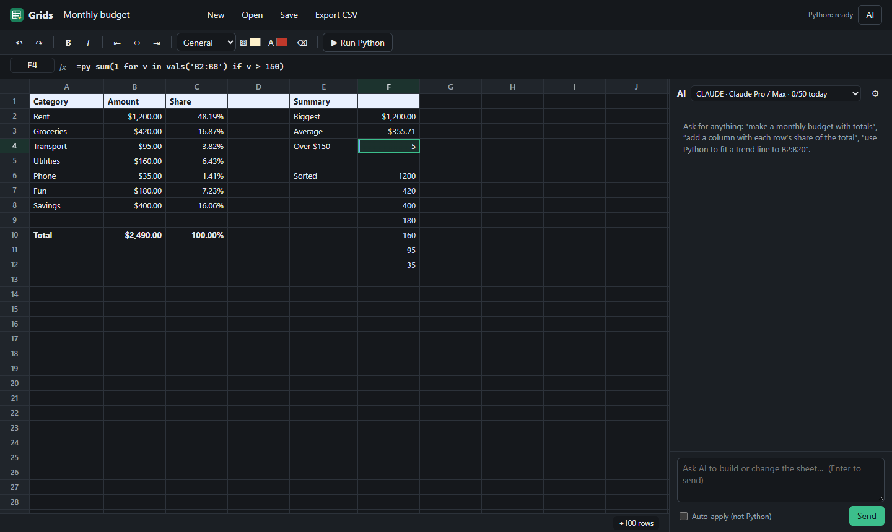
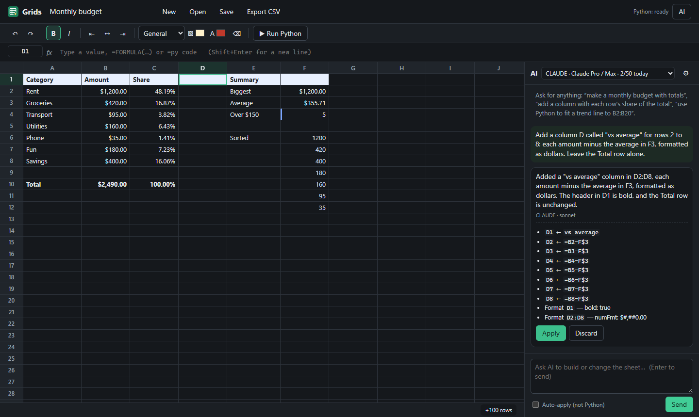
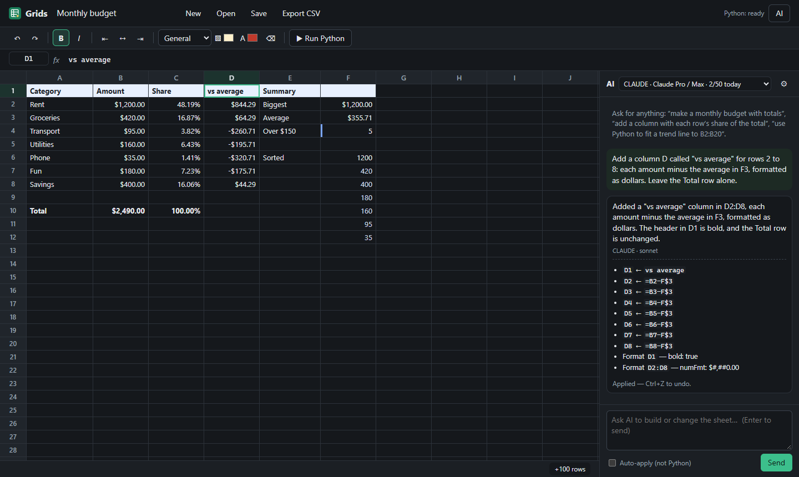
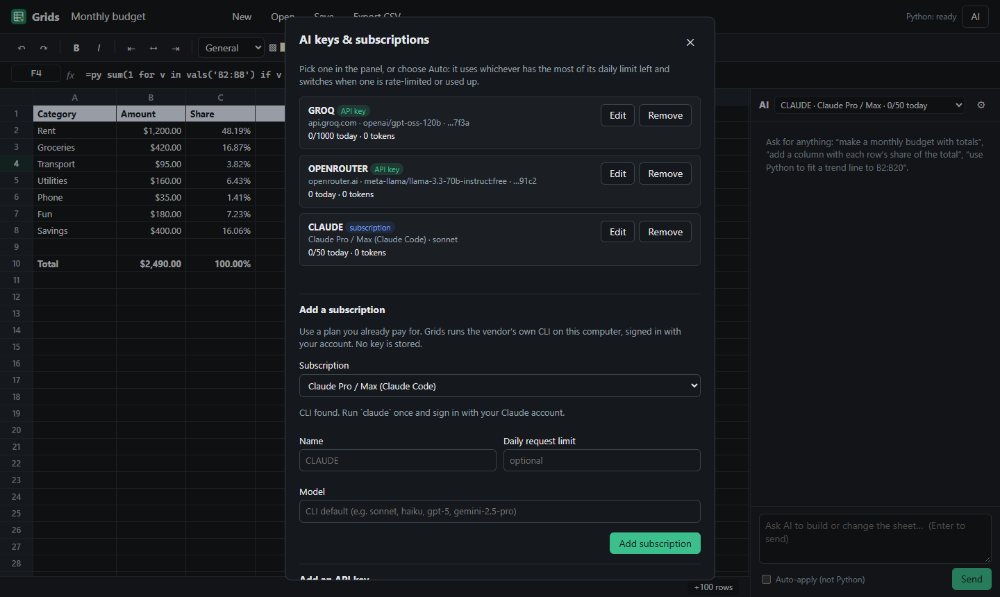
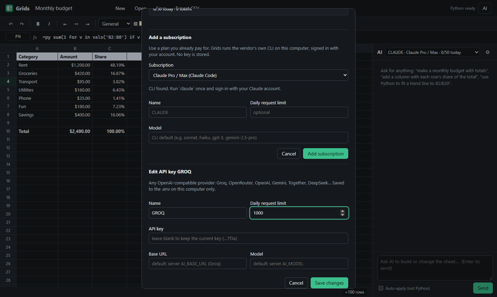
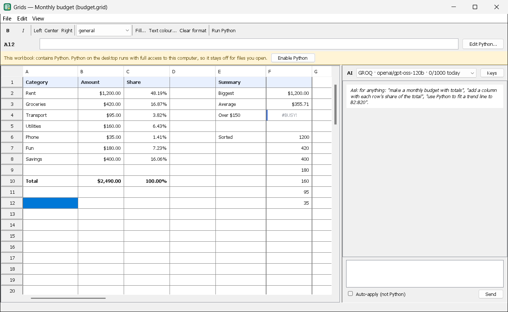
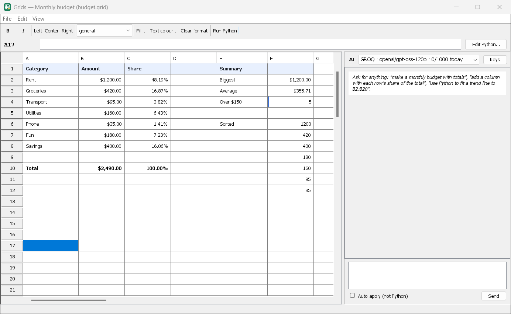
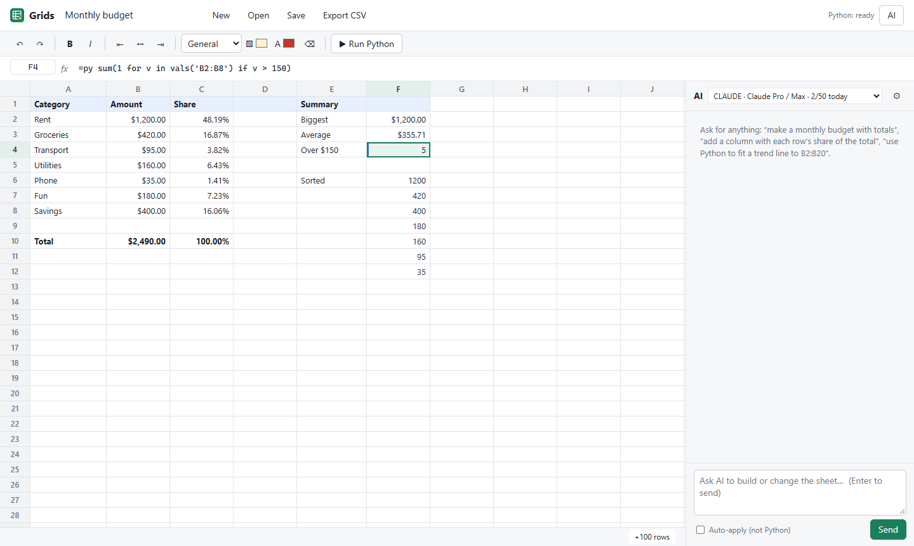

# Grids

A spreadsheet with an AI built in. Bring your own key or subscription, and type Python
into cells next to normal formulas.



- **Formulas**: `=SUM(B2:B9)`, `IF`, `IFERROR`, `ROUND`, text functions, and `SORT` /
  `SEQUENCE` / `TRANSPOSE` with spilling arrays. That's 26 functions so far; there is no
  `VLOOKUP`, `SUMIF` or dates yet, so use a Python cell for those. The full list is in
  [shared/FORMULAS.md](shared/FORMULAS.md).
- **Python cells**: start a cell with `=py `, e.g. `=py sum(vals('B1:B9'))`. A cell can
  hold a whole script, and its last value can be a number, a list or a table. The result
  spills like a formula. Formulas can read Python results and Python
  can read cells, and a cell reruns when anything it read changes.
- **AI**: ask it to build or change the sheet. It proposes changes and you Apply or
  Discard them, as one undo step. It works with any OpenAI-compatible provider (Groq,
  OpenRouter, OpenAI, Gemini, Ollama…) or a plan you already pay for (Claude Pro/Max,
  ChatGPT Plus/Pro, Google AI) through that vendor's CLI.
- **Keys**: several keys and subscriptions live in one local `.env`. You can add, edit
  and remove them in either app. Usage is tracked per day, and **Auto** switches to
  whichever connection has headroom. The file is readable by your user account only, and
  keys never reach the page, the usage file or the logs. See [shared/KEYS.md](shared/KEYS.md).
- **Outside AIs (MCP)**: Claude Code, Claude Desktop, Cursor and other MCP clients can
  read and edit your workbooks directly through `web/mcp.js`. See [below](#connect-an-outside-ai-mcp).

Two apps share one file format ([shared/FORMAT.md](shared/FORMAT.md)) and one formula test
suite:

| | Stack | Python runs in |
|---|---|---|
| `web/` | Node ≥ 22, no dependencies | the browser (Pyodide), sandboxed |
| `desktop/` | Java 21+, Swing, no build tool | local CPython, with full access, so it is **off for files you open** until you click *Enable Python* |

## Run

```bash
# website: http://127.0.0.1:5173
cd web && npm start

# desktop (Windows: .\build.ps1 -Run)
cd desktop && ./build.sh --run
```

To try it with data, open [examples/budget.grid](examples/budget.grid) (**Open** in either
app, or `java -jar grids.jar examples/budget.grid`). It mixes plain values, formulas, a
spilled `SORT` and one Python cell.

## Tour

### Ask the AI, then Apply or Discard

The AI proposes a list of cell edits and formats. Nothing changes until you click
**Apply**, and then it is a single undo step.

| Proposal | Applied |
|---|---|
|  |  |

### Keys and subscriptions

Open the AI panel and click **⚙** (web) or **Keys** (desktop). Each connection shows
its type, model, the last 4 characters of the key and today's usage. **Edit** keeps the
stored key unless you type a new one, and **Remove** asks first.

| Connections | Editing a key |
|---|---|
|  |  |

### Desktop app

The same workbook in the Swing app. A file you open keeps Python off until you click
*Enable Python*, because desktop Python runs with full access to your computer.

| Opened (Python off) | After *Enable Python* |
|---|---|
|  |  |

The web app follows your system's light or dark theme:



## Set up

```bash
cd web && npm run setup
```

The setup script walks you through:
- **Where your keys live.** It offers `~/.grids/.env`, outside the project folder, and
  recommends it when the project sits in OneDrive, Dropbox or iCloud.
- **Your AI connections.** Add, edit or remove API keys and subscriptions, and pick the
  default. Keys are typed with the echo hidden.
- **Optionally, MCP.** It registers Grids with Claude Code and prints the config for other
  MCP clients.

Every step is optional. You can also manage connections in the app: open the AI panel and
click **⚙** (web) or **Keys** (desktop). Or copy `.env.example` to `.env` and fill it in.

The web server binds to `127.0.0.1` by default. Subscriptions and key editing only work
while it does: anyone who could reach a public server could otherwise spend your plan or
rewrite your keys (see [shared/KEYS.md](shared/KEYS.md)).

## Connect an outside AI (MCP)

`web/mcp.js` is a zero-dependency [MCP](https://modelcontextprotocol.io) server. An AI
connected to it can:
- list, read and create workbooks;
- use the same edit tools as the built-in AI: `set_cells`, `clear_range`,
  `format_range`, `set_column_width`, `set_title`;
- look up the formula reference.

`npm run setup` registers it with Claude Code for you. By hand:

```bash
claude mcp add --scope user grids -- node /path/to/grids/web/mcp.js --dir ~/Grids
```

Other clients (such as Claude Desktop's `claude_desktop_config.json`) take:

```json
{ "mcpServers": { "grids": { "command": "node", "args": ["/path/to/grids/web/mcp.js", "--dir", "/home/you/Grids"] } } }
```

Limits on what it can touch:
- It only reaches `.grid` files in the one workspace folder: `--dir`, else
  `GRIDS_WORKSPACE`, else `~/Grids`. Workbook names are plain file names, never paths.
- It never runs Python. Both apps open files with Python off until you click
  *Enable Python*, so you review any Python an AI wrote before it runs.
- Edits are saved to the file at once. Open the file in the app (File → Open) to see them;
  an app that already has it open won't pick them up live yet.

## Uninstall

Run the uninstall script in the Grids folder:

| OS | Command |
|---|---|
| Windows | double-click `uninstall.cmd`, or run it in a terminal |
| macOS / Linux | `sh uninstall.sh` |

It asks before each step, and every question except the build output defaults to *no*:
1. It removes Grids from Claude Code's MCP servers.
2. It offers to delete each key file and its usage counts.
3. It offers to delete the desktop build output.
4. It offers to delete the Grids folder itself, warning first if it has uncommitted changes.

Your workbooks are never deleted. For other MCP clients, remove their `grids` entry by hand.
Without Node, the script prints these steps for you to do by hand.
`cd web && npm run uninstall` does the same, apart from deleting the folder.

## Status

This is an early v0:
- Only one sheet per workbook is used.
- There are no charts and no real-time collaboration yet.
- The Codex (ChatGPT) subscription path has not been tested against the real CLI.
- The MCP server edits files; it can't yet drive a workbook that's open in an app.

## Test

```bash
cd web && npm test                        # formula engine, AI module, key ring, guards, MCP, setup
cd desktop && ./build.sh --smoke          # formula fixtures + desktop smoke (needs Python)
```

## License

[MIT](LICENSE) © 2026 PyMite6941
